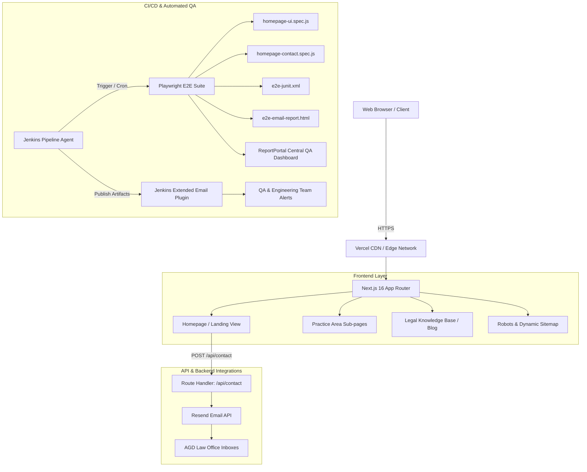

# AGD Law Associates (`agdlaw`) — Knowledge Transfer (KT) & Production Operations Guide

> **Production Domain:** [https://www.agdlawassociates.in](https://www.agdlawassociates.in)  
> **Repository:** `Umar-Zansphere/agdlaw`  
> **Primary Stack:** Next.js 16 (App Router) • React 19 • Tailwind CSS v4 • Playwright • Jenkins CI/CD • Resend API • ReportPortal  
> **Headquarters:** Chennai, Tamil Nadu, India  

---

## Table of Contents

1. [Executive Summary & Business Overview](#1-executive-summary--business-overview)
2. [High-Level System Architecture](#2-high-level-system-architecture)
3. [Repository Structure](#3-repository-structure)
4. [Environment Variables & Configuration Matrix](#4-environment-variables--configuration-matrix)
5. [Local Development & Build Workflow](#5-local-development--build-workflow)
6. [Consultation Intake & Transactional Email Pipeline](#6-consultation-intake--transactional-email-pipeline)
7. [End-to-End Testing & QA Suite (Playwright)](#7-end-to-end-testing--qa-suite-playwright)
8. [Continuous Integration & Delivery (Jenkins Pipeline)](#8-continuous-integration--delivery-jenkins-pipeline)
9. [SEO, Structured Data & Web Analytics](#9-seo-structured-data--web-analytics)
10. [Content Operations & Extension Guide](#10-content-operations--extension-guide)
11. [Troubleshooting, Gotchas & Production Runbook](#11-troubleshooting-gotchas--production-runbook)
12. [Knowledge Transfer (KT) Handover Checklist](#12-knowledge-transfer-kt-handover-checklist)

---

## 1. Executive Summary & Business Overview

**AGD Law Associates** is a premier boutique law firm based in Chennai, delivering precision-driven litigation, dispute resolution, constitutional remedies, and corporate advisory services across Tamil Nadu and pan-India.

### Core Legal Practice Areas
- **Criminal Defense & Bail:** Anticipatory bail (Section 438 CrPC / BNSS), regular bail, trial defense, FIR quashing (Section 482 CrPC), white-collar defense, appellate advocacy before the Madras High Court.
- **Civil Litigation:** Property disputes, partition suits, recovery proceedings, declaration suits, injunctions, and execution petitions.
- **Constitutional Law & Writs:** Article 226/32 petitions, Habeas Corpus, Mandamus, Certiorari, and administrative tribunal representation.
- **Property & Real Estate:** Comprehensive title verification, purchase due diligence, lease drafting, registration advisory, and encumbrance investigations.
- **Corporate Advisory & Commercial Law:** Shareholder agreements, commercial contract drafting, dispute management, and MSME/arbitration matters.
- **Family & Matrimonial Disputes:** Divorce, mutual consent petitions, child custody, maintenance, and domestic violence protection matters.
- **Arbitration & Alternate Dispute Resolution (ADR):** Section 9, 11, and 34 applications under the Arbitration & Conciliation Act.
- **Consumer Protection:** District, State, and National Consumer Commission representations.
- **MCOP & Rent Control:** Motor accident claims tribunals and rent control/tenancy disputes under Tamil Nadu tenancy laws.

### AGD Ventures Wing
A dedicated real estate and transactional legal scrutiny division providing:
- 30-year parent document scrutiny and title flow analysis.
- Encumbrance certificate (EC) forensic audits.
- Revenue records verification (Patta, Chitta, Adangal, FMB sketches).
- Regulatory approvals verification (CMDA, DTCP, RERA Tamil Nadu).

---

## 2. High-Level System Architecture



### Core Technologies
| Component | Technology | Version / Specification | Role |
| :--- | :--- | :--- | :--- |
| **Framework** | Next.js | `16.2.1` | App Router, SSR, SSG static route generation, Turbopack support |
| **UI Runtime** | React | `19.2.4` | Component state, React Compiler optimizations (`babel-plugin-react-compiler`) |
| **Styling** | Tailwind CSS & PostCSS | `v4` | Design system, responsive layouts, micro-animations |
| **Icons** | Lucide React | `^1.7.0` | Vector iconography |
| **Typography** | Google Fonts | DM Sans, Cormorant Garamond | Legal editorial styling |
| **Email Service** | Resend REST API | `v1` | Branded HTML email consultation requests |
| **E2E Testing** | Playwright | `^1.51.1` | Headless Chromium regression & UI automation |
| **QA Dashboard**| ReportPortal | Agent `^5.4.0` | Centralized test execution telemetry |
| **CI/CD** | Jenkins | Declarative Pipeline | Scheduled daily test execution, reporting, log archiving |

---

## 3. Repository Structure

```
agdlaw/
├── .gitignore                      # Root Git ignore rules (builds, caches, secrets, test artifacts)
├── Jenkinsfile                     # Declarative CI/CD pipeline for Jenkins
├── frontend/                       # Next.js web application root
│   ├── .env.example                # Sample environment variables with placeholders
│   ├── .gitignore                  # Frontend specific ignore rules
│   ├── AGENTS.md                   # Agent developer instruction & nextjs version notes
│   ├── CLAUDE.md                   # Claude / assistant context pointer
│   ├── eslint.config.mjs           # ESLint 9 flat configuration with next-vitals
│   ├── jsconfig.json               # Path alias resolution (@/* -> ./src/*)
│   ├── next.config.mjs             # Next.js configuration (reactCompiler, remote image patterns)
│   ├── package.json                # Dependencies, scripts, and engine specifications
│   ├── pnpm-lock.yaml              # PNPM deterministic dependency lockfile
│   ├── pnpm-workspace.yaml         # Workspace configuration
│   ├── postcss.config.mjs          # PostCSS configuration for Tailwind v4
│   ├── tailwind.config.js          # Tailwind styling customization
│   ├── playwright.config.js        # Playwright test config, reporters, webServer harness
│   ├── public/                     # Static assets (favicons, SVGs, high-res hero imagery)
│   │   ├── hero.png                # OpenGraph & social preview image (1200x630)
│   │   ├── logo1.png               # High-resolution emblem logo
│   │   ├── site.webmanifest        # PWA / browser manifest
│   │   └── googlebf2aad72db4766ad.html # Google Search Console ownership verification
│   ├── src/
│   │   ├── app/                    # Next.js 16 App Router
│   │   │   ├── layout.jsx          # Root layout, HTML skeleton, global SEO metadata
│   │   │   ├── globals.css         # Global CSS variables & Tailwind imports
│   │   │   ├── page.jsx            # Main interactive landing page (Hero, Services, Team, FAQ, Contact)
│   │   │   ├── robots.js           # Dynamic /robots.txt generation
│   │   │   ├── sitemap.js          # Dynamic /sitemap.xml generation (static, services, blog)
│   │   │   ├── api/
│   │   │   │   └── contact/
│   │   │   │       └── route.js    # Resend email handler (sanitization, HTML template, dispatch)
│   │   │   ├── blog/
│   │   │   │   ├── page.jsx        # Blog listing / articles index page
│   │   │   │   └── [slug]/
│   │   │   │       └── page.jsx    # Dynamic blog article renderer with static generation
│   │   │   └── services/
│   │   │       └── [slug]/
│   │   │           └── page.jsx    # Dynamic practice area page renderer with static generation
│   │   ├── components/
│   │   │   ├── AGDLogoImg.jsx      # Reusable brand logo component
│   │   │   ├── practice-areas.jsx  # Rich practice area detail templates & data
│   │   │   └── blog-pages.jsx      # Blog directory & article reading layout components
│   │   ├── data/
│   │   │   └── blog-posts.js       # Curated legal articles, author metadata, and reading time
│   │   └── lib/
│   │       └── site.js             # Global site metadata, canonical constants, and practice slugs
│   └── tests/
│       └── e2e/
│           ├── homepage-ui.spec.js # E2E specs for all homepage sections and navigation
│           ├── homepage-contact.spec.js # E2E specs for contact form validation & API flows
│           └── reporters/
│               └── email-html-reporter.js # Custom email-friendly HTML reporter for Jenkins
```

---

## 4. Environment Variables & Configuration Matrix

Create a `.env.local` inside the `frontend/` directory (or configure these in your hosting provider / Jenkins credentials):

| Variable | Environment | Required | Default / Example | Purpose |
| :--- | :--- | :--- | :--- | :--- |
| `RESEND_API_KEY` | Server | **Yes** | `re_1234567890abcdef...` | Authentication token for the Resend transactional email API. |
| `RESEND_FROM_EMAIL` | Server | **Yes** | `AGD Law <consultation@agdlawassociates.in>` | Verified sending identity configured in your Resend account. |
| `CONTACT_TO_EMAIL` | Server | No | `agdlawassociatesoffice@gmail.com` | Target mailbox for intake inquiries. Defaults to `RESEND_FROM_EMAIL` if omitted. |
| `RP_API_KEY` | CI / E2E | No | `automation-tests_xxx...` | ReportPortal user token for reporting test execution runs. |
| `GOOGLE_SITE_VERIFICATION` | Build / SSR | No | `googlebf2aad72db4766ad` | Search Console verification token added to `<meta name="google-site-verification">`. |
| `PORT` | Local / E2E | No | `3000` | Port used by the local web server and Playwright test harness. |
| `HOST` | Local / E2E | No | `127.0.0.1` | Network interface host used by Playwright webServer. |
| `PLAYWRIGHT_HTML_EMAIL_REPORT` | CI / E2E | No | `test-results/e2e-email-report.html` | Custom destination path for Jenkins email HTML report. |
| `E2E_REPORT_RECIPIENTS` | Jenkins | No | Comma-delimited emails | Email addresses alerted by the Jenkins `emailext` plugin after runs. |
| `CI` | CI | Automatic | `'true'` | Enables strict Playwright checks (retries = 2, workers = 1, forbidOnly = true). |

> [!SECURITY]
> **Never commit `.env` or `.env.local` to Git.**  
> Always keep sample keys updated in `frontend/.env.example` with masked placeholders.

---

## 5. Local Development & Build Workflow

### Prerequisites
- **Node.js:** v20.x or higher (LTS recommended)
- **Package Manager:** `pnpm` (recommended, v9+) or `npm` (v10+)
- **Git:** v2.30+

### Setup Instructions

1. **Clone the repository:**
   ```bash
   git clone https://github.com/Umar-Zansphere/agdlaw.git
   cd agdlaw/frontend
   ```

2. **Install dependencies:**
   ```bash
   pnpm install
   # Or using npm:
   # npm install
   ```

3. **Configure local environment:**
   ```bash
   cp .env.example .env.local
   # Update .env.local with valid test keys (e.g. RESEND_API_KEY)
   ```

4. **Start development server:**
   ```bash
   pnpm dev
   # Or using npm:
   # npm run dev
   ```
   Open [http://localhost:3000](http://localhost:3000) in your browser. Fast Refresh and Turbopack hot reloading are active.

5. **Linting and code quality:**
   ```bash
   pnpm lint
   # Or:
   # npm run lint
   ```

6. **Production build & verification:**
   ```bash
   pnpm build
   pnpm start
   ```

---

## 6. Consultation Intake & Transactional Email Pipeline

The consultation request workflow connects prospective clients directly with managing counsel.

### Pipeline Flow:
1. **User Interaction:** Client fills the consultation form located at `#contact` on the landing page:
   - Full Name (`your_name`)
   - Email Address (`your_email`)
   - Phone Number (`your_phone`)
   - Legal Service Required (`service_type`) — mapped via `SERVICE_MAP`
   - Preferred Timeline (`budget` / timeline) — mapped via `TIMELINE_MAP`
   - Detailed Case Overview (`message`)
2. **Client-Side Validation:** Ensures all required fields are chosen before allowing submission.
3. **API Processing (`frontend/src/app/api/contact/route.js`):**
   - **Sanitization:** All string inputs are passed through `escapeHtml()` to neutralize XSS vectors (`&`, `<`, `>`, `"`, `'`).
   - **Timestamping:** Converts submission timestamp to Indian Standard Time (IST / Asia/Kolkata timezone).
   - **Branded HTML Email Construction:** Inlines a dual-tone executive email template (Forest green `#18352c` and Gold `#b88b4a`) with prominent contact badges and a one-click `Reply to Client` mailto action.
   - **Text Fallback:** Creates a structured plain-text fallback payload.
   - **Resend Dispatch:** Dispatches to `https://api.resend.com/emails` with `reply_to` pointing directly to the client's email address.
   - **Error Handling:** Returns `400` on missing fields, `500` if environment credentials are unset, and `502` if upstream Resend responds with failure.

---

## 7. End-to-End Testing & QA Suite (Playwright)

The project includes an enterprise-grade automated regression test suite built on Playwright.

### Test Coverage
- **`tests/e2e/homepage-ui.spec.js`:**
  - Header & navigation bar links (About, Services, Team, Insights, Contact).
  - Practice areas catalog rendering and routing to dynamic pages (`/services/[slug]`).
  - AGD Ventures real estate legal audit services section.
  - Team credentials and advocate profiles.
  - Interactive FAQ accordions expansion and collapse.
  - Responsive footer links and regulatory compliance disclaimer.
- **`tests/e2e/homepage-contact.spec.js`:**
  - Field rendering and validation triggers.
  - Selection enforcement for Service and Urgency dropdown buttons.
  - API submission mocking and successful status response verification.

### Running Tests Locally

```bash
# 1. Install browser binaries (first time only)
npx playwright install chromium

# 2. Run the complete headless test suite
pnpm test:e2e

# 3. Run in headed mode (watches browser execute tests)
pnpm test:e2e:headed

# 4. Open interactive Playwright UI Runner
pnpm test:e2e:ui
```

### Reporting Artifacts Generated
When tests run, four distinct reporters generate outputs:
1. **Console List:** Real-time terminal feedback.
2. **Playwright HTML Report (`frontend/playwright-report/`):** Full interactive report with traces, screenshots, and videos on failure.
3. **JUnit XML (`frontend/test-results/e2e-junit.xml`):** Machine-readable test execution report parsed by Jenkins.
4. **Email HTML Reporter (`frontend/test-results/e2e-email-report.html`):** Custom standalone reporter built specifically for HTML email clients (inline CSS, metrics breakdown, failed test error summaries).
5. **ReportPortal Agent:** Transmits execution data to an external ReportPortal instance when `RP_API_KEY` is provided.

---

## 8. Continuous Integration & Delivery (Jenkins Pipeline)

The repository root includes a production `Jenkinsfile` configuring an automated test runner.

### Jenkins Pipeline Highlights
- **Scheduled Trigger:** Runs automatically every morning at `11:00` server time via cron trigger: `cron('0 11 * * *')`.
- **Concurrency & History:** `disableConcurrentBuilds()` prevents overlap; `logRotator(numToKeepStr: '14')` preserves the last 14 builds.
- **Stages:**
  1. `Prepare Workspace`: Cleans previous `frontend/test-results` and `frontend/playwright-report` directories to ensure clean runs.
  2. `Install Dependencies`: Runs `npx pnpm install --frozen-lockfile`.
  3. `Run E2E Tests`: Ensures Chromium is installed and executes `npx pnpm test:e2e`.
- **Post-Build Pipeline:**
  - **Integrity Validation:** If the build passes but no fresh JUnit or HTML report was written, forces build state to `FAILURE`.
  - **Test Result Publishing:** Parses `frontend/test-results/e2e-junit.xml`.
  - **Artifact Archiving:** Saves all files matching `frontend/test-results/**` and `frontend/playwright-report/**`.
  - **Email Notification (`emailext`):** Dispatches the compiled `e2e-email-report.html` directly to `E2E_REPORT_RECIPIENTS` with full logs attached on failures.

---

## 9. SEO, Structured Data & Web Analytics

The platform is optimized for organic search discovery across legal terms in Tamil Nadu:

### 1. Metadata Architecture (`frontend/src/app/layout.jsx`)
- Canonical base: `https://www.agdlawassociates.in`.
- 40+ curated high-intent search keywords targeting Chennai courts, High Court writs, and property law.
- Geotagging metadata configured:
  - `geo.region`: `IN-TN`
  - `geo.placename`: `Chennai, Tamil Nadu, India`
  - `geo.position`: `13.0827;80.2707`
  - `service-area`: Chennai, Tambaram, Avadi, Chengalpattu, Coimbatore, Tiruppur, Bangalore.
- OpenGraph & Twitter Cards with 1200x630 social preview image (`/hero.png`).

### 2. Search Engine Indexing
- **Robots (`/robots.txt` via `frontend/src/app/robots.js`):** Permits all search engines to index public pages while disallowing `/api/`.
- **Sitemap (`/sitemap.xml` via `frontend/src/app/sitemap.js`):** Dynamically enumerates:
  - Root landing page (`/`)
  - Blog index (`/blog`)
  - All 9 service routes (`/services/[slug]`)
  - All published blog articles (`/blog/[slug]`) with article publication dates.
- **Google Search Console:** Verified via `/googlebf2aad72db4766ad.html` and environment verification token.

---

## 10. Content Operations & Extension Guide

### Adding a New Practice Area
1. Open `frontend/src/lib/site.js` and add the new slug to `practiceAreaSlugs`:
   ```javascript
   export const practiceAreaSlugs = [
     // ...,
     "cyber-crime-it-act",
   ];
   ```
2. Open `frontend/src/components/practice-areas.jsx` and add the detailed service content into `practiceAreas` data map (including title, description, key legal remedies, statutes, and FAQs).
3. The dynamic route `/services/[slug]` and `/sitemap.xml` will automatically pick up the new practice area with zero routing code changes.

### Publishing a New Legal Article
1. Open `frontend/src/data/blog-posts.js`.
2. Add a new article object to the `blogPosts` array:
   ```javascript
   {
     slug: "new-criminal-laws-bnss-guide",
     category: "Criminal Law",
     title: "Understanding Bharatiya Nagarik Suraksha Sanhita (BNSS)",
     excerpt: "A comprehensive guide on procedural changes in bail and investigation.",
     author: "AGD Bala Kumar",
     authorRole: "Managing Counsel, AGD Law Associates",
     date: "October 15, 2026",
     readTime: "7 min read",
     img: "https://images.unsplash.com/...",
     heroImg: "https://images.unsplash.com/...",
     featured: false,
     relatedSlugs: ["anticipatory-bail-guide-india"],
     content: [
       { type: "lead", text: "..." },
       { type: "h2", text: "Key Changes" },
       { type: "p", text: "..." }
     ]
   }
   ```
3. The article is automatically published at `/blog/new-criminal-laws-bnss-guide`, linked on the `/blog` index, and added to the XML sitemap.

---

## 11. Troubleshooting, Gotchas & Production Runbook

### Common Issues & Remediation

| Symptom | Probable Cause | Resolution |
| :--- | :--- | :--- |
| **Contact form returns HTTP 500** | Missing `RESEND_API_KEY` or `RESEND_FROM_EMAIL`. | Verify that environment variables are loaded in `.env.local` or production container. |
| **Contact form returns HTTP 502** | Resend API rejected request (unverified sender domain or rate limit). | Check Resend Dashboard. Ensure sender domain DNS records (DKIM, SPF) are verified. |
| **Playwright tests fail on local machine with port error** | Another process is already running on port 3000. | Stop the existing server or specify an alternate port: `PORT=3001 pnpm test:e2e`. |
| **Jenkins build fails at `Run E2E Tests`** | Chromium binary missing on Jenkins agent. | Add `bat 'npx playwright install chromium'` before the test command (already configured in `Jenkinsfile`). |
| **Jenkins sends email saying "No fresh reports"** | Playwright crashed before writing test results. | Check Jenkins console output for Node/PNPM runtime crashes. |
| **Images from external URLs fail to render** | Domain not whitelisted in Next.js image optimizer. | Add the hostname to `images.remotePatterns` in `frontend/next.config.mjs`. |

---

## 12. Knowledge Transfer (KT) Handover Checklist

For newly onboarded developers, QA engineers, or DevOps personnel:

- [ ] **Access & Credentials:**
  - [ ] GitHub repository access (`Umar-Zansphere/agdlaw`).
  - [ ] Resend dashboard access (to monitor email quotas & domain health).
  - [ ] Jenkins build server credentials.
  - [ ] Google Search Console access for domain `agdlawassociates.in`.
  - [ ] Hosting platform / Vercel deployment project access.
- [ ] **Local Machine Setup:**
  - [ ] Node.js v20+ and `pnpm` installed.
  - [ ] Repository cloned and dependencies installed via `pnpm install`.
  - [ ] Verified local dev server boots on `http://localhost:3000`.
- [ ] **QA & Pipeline Verification:**
  - [ ] Run `pnpm test:e2e` locally to verify all tests pass on Chromium.
  - [ ] Inspect generated `frontend/test-results/e2e-email-report.html`.
  - [ ] Review `Jenkinsfile` and verify credentials parameter `RP_API_KEY` matches Jenkins credentials store.
- [ ] **Production Health Checks:**
  - [ ] Verify homepage loads at `https://www.agdlawassociates.in`.
  - [ ] Submit a test contact consultation request and verify email arrival in the firm's inbox.
  - [ ] Verify `https://www.agdlawassociates.in/sitemap.xml` renders valid XML.
  - [ ] Verify `https://www.agdlawassociates.in/robots.txt` is accessible.
