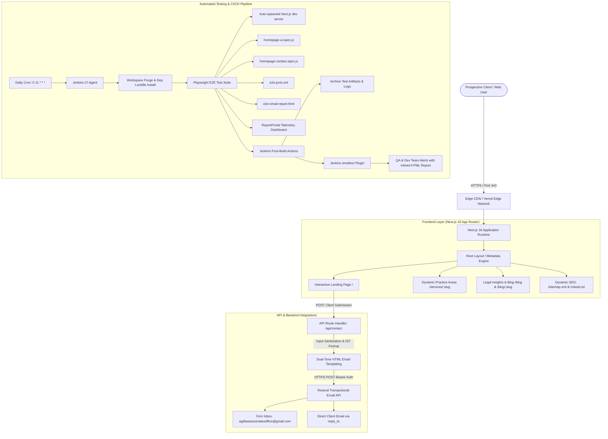
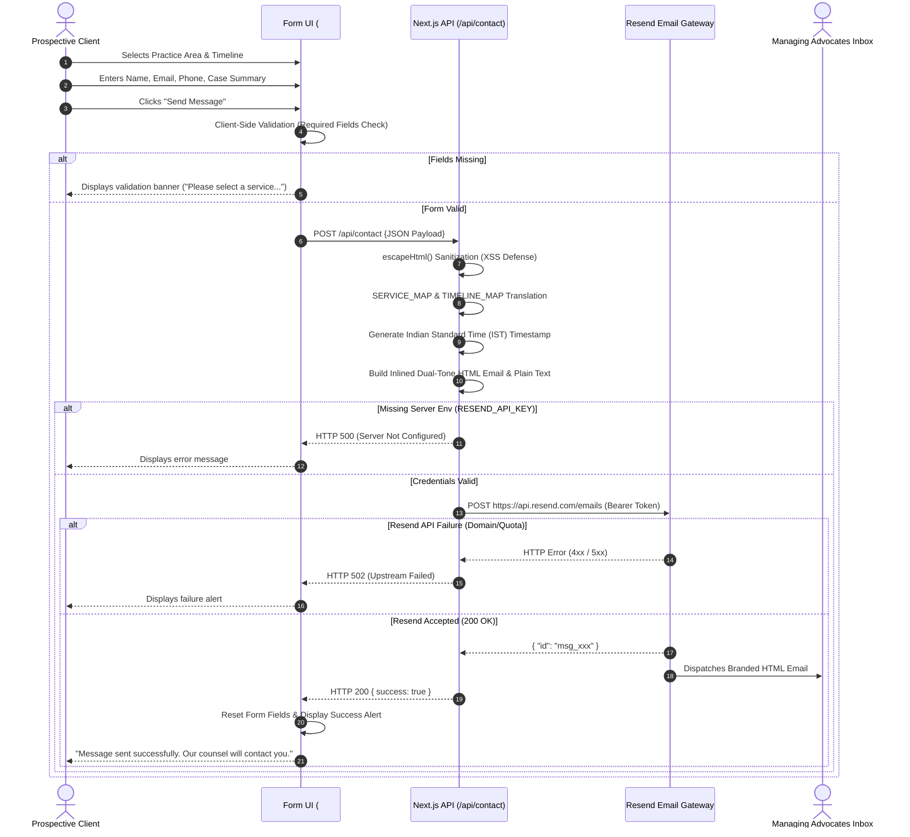
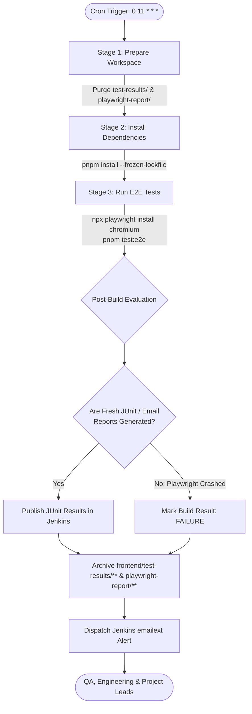

# AGD Law Associates (`agdlaw`) — Comprehensive Technical Knowledge Transfer (KT) Document

> **Confidentiality / Target Audience:** Engineering, QA Automation, DevOps, Product, and Newly Onboarded Maintainers  
> **Repository:** `Umar-Zansphere/agdlaw`  
> **Production Domain:** [https://www.agdlawassociates.in](https://www.agdlawassociates.in)  
> **Primary Stack:** Next.js 16 (App Router) • React 19 • Tailwind CSS v4 • Playwright E2E • Jenkins CI/CD • Resend API • ReportPortal  
> **Jurisdiction & Headquarters:** Chennai, Tamil Nadu, India  

---

## Table of Contents

1. [Executive Summary & System Purpose](#1-executive-summary--system-purpose)
2. [High-Level System Architecture](#2-high-level-system-architecture)
3. [Technology Stack & Dependency Breakdown](#3-technology-stack--dependency-breakdown)
4. [Repository Directory & File Catalog](#4-repository-directory--file-catalog)
5. [Consultation Intake & Transactional Email Pipeline](#5-consultation-intake--transactional-email-pipeline)
6. [SEO, Structured Data & Geotagging Architecture](#6-seo-structured-data--geotagging-architecture)
7. [Automated Quality Assurance & Playwright E2E Suite](#7-automated-quality-assurance--playwright-e2e-suite)
8. [Continuous Integration & Delivery (Jenkins Pipeline)](#8-continuous-integration--delivery-jenkins-pipeline)
9. [Configuration, Environment Variables & Secret Management](#9-configuration-environment-variables--secret-management)
10. [Local Development, Build & Tooling Setup](#10-local-development-build--tooling-setup)
11. [Content Operations & System Extension Guide](#11-content-operations--system-extension-guide)
12. [Production Operations, Monitoring & Runbook](#12-production-operations-monitoring--runbook)
13. [Knowledge Transfer Handover & 30-60-90 Day Roadmap](#13-knowledge-transfer-handover--30-60-90-day-roadmap)

---

## 1. Executive Summary & System Purpose

### 1.1 Business Mission
**AGD Law Associates** is an established boutique law firm operating out of Chennai, Tamil Nadu, delivering trial defense, High Court appellate advocacy, civil dispute management, constitutional remedies, and corporate advisory pan-India. 

The firm also operates **AGD Ventures**, a specialized real estate and transactional legal scrutiny division providing 30-year parent document due diligence, Encumbrance Certificate (EC) forensic audits, revenue records verification (Patta/Chitta/FMB), and regulatory approval compliance (CMDA/DTCP/RERA Tamil Nadu).

### 1.2 Regulatory Compliance Notice (Bar Council of India)
Under **Rule 36 of the Bar Council of India (BCI) Rules**, advocates and law firms in India are strictly prohibited from soliciting work or advertising legal services. The platform is engineered to function strictly as an informative digital directory and educational resource:
- The website displays no subjective claims of superiority or solicitation.
- The footer and consultation modules incorporate explicit statutory disclaimers stating that information provided does not constitute legal advice and that access does not create an attorney-client privilege until formal engagement.

### 1.3 System Objectives
1. **High-Performance Public Portal:** Ultra-fast, responsive web interface showcasing legal practice areas, partner credentials, court jurisdictions, and published legal insights.
2. **Automated Consultation Intake:** Seamless, secure client intake pipeline routing consultation requests into the firm's inbox via Resend transactional email API.
3. **Automated Continuous QA:** Headless browser automation running daily via Jenkins to verify UI integrity, form validation, and external API integrations.
4. **Search Visibility (SEO):** Rich JSON-LD microdata, dynamic sitemaps, and localized keywords to capture organic search traffic across Tamil Nadu courts and tribunals.

---

## 2. High-Level System Architecture

The application adopts modern Jamstack and Next.js App Router patterns, utilizing Server-Side Rendering (SSR), Static Site Generation (SSG), Edge CDN distribution, and external microservices.



---

## 3. Technology Stack & Dependency Breakdown

### 3.1 Core Frameworks & Runtimes
| Layer | Technology | Version | Purpose |
| :--- | :--- | :--- | :--- |
| **Framework** | Next.js | `16.2.1` | App Router architecture, hybrid SSG/SSR, static asset optimization |
| **UI Library** | React | `19.2.4` | Modern component model, server components, and concurrent rendering |
| **Compiler** | Babel React Compiler | `1.0.0` | Memoization and render tree optimizations via `reactCompiler: true` |
| **Styling** | Tailwind CSS & PostCSS | `v4.0.0` | Utility-first CSS, modern CSS variable architecture, `@tailwindcss/postcss` |
| **Vector Icons** | Lucide React | `^1.7.0` | Accessible, tree-shakeable UI iconography |
| **Motion** | Framer Motion | `^12.38.0` | Smooth entry transitions and mobile navigation overlays |
| **Typography** | `next/font/google` | Built-in | Zero-layout-shift Google Fonts: `DM Sans` (body) & `Cormorant Garamond` (display) |

### 3.2 Testing & Quality Assurance
| Component | Tool / Package | Version | Purpose |
| :--- | :--- | :--- | :--- |
| **E2E Automation** | `@playwright/test` | `^1.51.1` | Cross-browser headless UI automation and API mocking |
| **Central QA Telemetry** | `@reportportal/agent-js-playwright` | `^5.4.0` | Real-time reporting of test metrics and historical trends |
| **Custom Reporter** | `email-html-reporter.js` | In-house | Generates standalone email-client compatible HTML summaries |
| **Machine Reporting** | JUnit XML Reporter | Built-in | Parses test pass/fail tallies into Jenkins build charts |

### 3.3 Infrastructure & Third-Party Integrations
| Service | Provider / Protocol | Role |
| :--- | :--- | :--- |
| **Transactional Email** | Resend API (`v1`) | Delivers branded consultation emails with client `reply_to` headers |
| **Continuous Integration** | Jenkins Pipeline | Automated daily regressions, workspace sanitization, and alert dispatches |
| **Search Engine Verification**| Google Search Console | DNS / HTML verification for domain indexation |
| **Hosting Target** | Vercel / Node LTS Server | Production hosting with edge caching and static route deployment |

---

## 4. Repository Directory & File Catalog

```
agdlaw/
├── .gitignore                          # Global git ignores (.next, node_modules, test-results, secrets)
├── Jenkinsfile                         # Declarative Jenkins CI/CD pipeline definition
├── README.md                           # Quick-start documentation and operations summary
├── TECHNICAL_KNOWLEDGE_TRANSFER.md     # This comprehensive technical KT document
└── frontend/                           # Web application root
    ├── .env.example                    # Template for required environment variables
    ├── eslint.config.mjs               # ESLint 9 flat configuration with next-vitals
    ├── jsconfig.json                   # Path alias mappings (@/* -> ./src/*)
    ├── next.config.mjs                 # Next.js runtime configuration & remote image whitelist
    ├── package.json                    # Project dependencies and script declarations
    ├── pnpm-lock.yaml                  # Deterministic dependency lockfile
    ├── postcss.config.mjs              # PostCSS pipeline for Tailwind v4
    ├── tailwind.config.js              # Theme extensions and palette configuration
    ├── playwright.config.js            # Playwright multi-reporter and webServer test harness
    ├── public/                         # Public static assets
    │   ├── favicon.ico                 # Standard browser favicon
    │   ├── favicon-16x16.png           # 16x16 PNG favicon
    │   ├── favicon-32x32.png           # 32x32 PNG favicon
    │   ├── apple-touch-icon.png        # 180x180 iOS home-screen icon
    │   ├── hero.png                    # 1200x630 OpenGraph / Twitter social card banner
    │   ├── logo1.png                   # Emblem and seal of AGD Law Associates
    │   ├── site.webmanifest            # PWA application manifest
    │   └── googlebf2aad72db4766ad.html # Google Search Console ownership verification token
    ├── src/
    │   ├── app/                        # Next.js App Router root
    │   │   ├── layout.jsx              # Global root layout, HTML envelope, SEO metadata
    │   │   ├── globals.css             # CSS reset, variables, and Tailwind directives
    │   │   ├── page.jsx                # Interactive homepage (Hero, About, Ventures, Services, FAQ, Contact)
    │   │   ├── robots.js               # Dynamic /robots.txt route handler
    │   │   ├── sitemap.js              # Dynamic /sitemap.xml route handler (32+ routes)
    │   │   ├── api/
    │   │   │   └── contact/
    │   │   │       └── route.js        # Serverless API endpoint handling consultation dispatch via Resend
    │   │   ├── blog/
    │   │   │   ├── page.jsx            # Articles directory and legal insights catalog
    │   │   │   └── [slug]/
    │   │   │       └── page.jsx        # Dynamic SSG blog post renderer with static params
    │   │   └── services/
    │   │       └── [slug]/
    │   │           └── page.jsx        # Dynamic SSG practice area renderer with static params
    │   ├── components/                 # Reusable UI component modules
    │   │   ├── AGDLogoImg.jsx          # Vector/raster hybrid brand logo component
    │   │   ├── blog-pages.jsx          # Blog directory, reading layouts, and share drawers
    │   │   └── practice-areas.jsx      # Comprehensive legal practice templates and statute directories
    │   ├── data/
    │   │   └── blog-posts.js           # Curated legal articles, authors, reading times, and body blocks
    │   └── lib/
    │       └── site.js                 # Global constants: URLs, practice slugs, and metadata fallbacks
    └── tests/
        └── e2e/                        # Playwright automated test suite
            ├── homepage-ui.spec.js     # UI rendering, responsive menus, anchor routing, and external links
            ├── homepage-contact.spec.js# Form validation, dropdown requirements, mock submission & resets
            └── reporters/
                └── email-html-reporter.js # Standalone HTML email reporter for Jenkins automation
```

### 4.1 In-Depth File Descriptions

#### [frontend/src/app/layout.jsx](file:///d:/Zansphere/agdlaw/frontend/src/app/layout.jsx)
- **Role:** Master root layout wrapping all routes.
- **Key Features:**
  - Implements standard metadata using Next.js Metadata API.
  - Generates OpenGraph and Twitter cards referencing `/hero.png`.
  - Injects Geotagging coordinates (`geo.region: IN-TN`, `geo.position: 13.0827;80.2707` for Chennai).
  - Enforces `en-IN` language tag and dark slate canvas background (`#0b0b0b`).

#### [frontend/src/app/page.jsx](file:///d:/Zansphere/agdlaw/frontend/src/app/page.jsx)
- **Role:** Main landing page representing the comprehensive web portal.
- **Key Modules Rendered:**
  - `Header`: Fixed blur-backed navigation with anchor links and mobile drawer.
  - `Hero`: Prominent firm positioning, primary CTA (`Request Consultation`), and core credentials.
  - `Ticker`: Key performance metrics (Years of experience, cases represented, property audits).
  - `About`: Founding principles, philosophy of advocacy, and trial litigation ethos.
  - `Ventures`: Dedicated showcase for **AGD Ventures** real estate verification services.
  - `Services`: Visual catalog of 9 core legal practice areas with links to deep-dive pages.
  - `Team`: Advocate profiles, roles, and high court experience.
  - `Regions`: Court jurisdictions (Madras High Court, City Civil, Subordinate Courts).
  - `Blog`: Preview of latest legal articles from the insights library.
  - `InstitutionalExperience`: Representation of banking, NBFC, corporate, and real estate clients.
  - `FAQ`: Accessible accordion addressing fees, confidential consultations, and case timelines.
  - `Contact`: Reactive intake form with dynamic urgency buttons and real-time validation.
  - `Footer`: Statutory BCI compliance disclaimers, dual Chennai office addresses, and branch details.
  - `WhatsAppFloatingChat`: Direct WhatsApp client bridge for swift communication.
  - `JSON-LD Schema`: Inlines structured schema for `LegalService` and `FAQPage`.

#### [frontend/src/app/api/contact/route.js](file:///d:/Zansphere/agdlaw/frontend/src/app/api/contact/route.js)
- **Role:** Serverless API handler receiving client intake submissions and dispatching them via Resend.
- **Security & Integrity:**
  - Custom `escapeHtml()` sanitizer against HTML injection/XSS.
  - Label normalization via `SERVICE_MAP` and `TIMELINE_MAP`.
  - Timestamp localization to Indian Standard Time (`Asia/Kolkata`).
  - Dual-tone responsive HTML email formatting with direct `mailto:` action button.
  - Plain text fallback generation.
  - HTTP 400 on incomplete input, HTTP 500 on unconfigured secrets, HTTP 502 on upstream Resend failures.

#### [frontend/src/app/services/[slug]/page.jsx](file:///d:/Zansphere/agdlaw/frontend/src/app/services/[slug]/page.jsx)
- **Role:** Dynamic route renderer for individual practice area pages.
- **Key Implementation:**
  - Uses `generateStaticParams()` to pre-render all 9 practice areas at build time.
  - Triggers `notFound()` if an unlisted slug is requested.
  - Consumes `<PracticeAreaPageContent />` from [practice-areas.jsx](file:///d:/Zansphere/agdlaw/frontend/src/components/practice-areas.jsx).

#### [frontend/src/app/blog/[slug]/page.jsx](file:///d:/Zansphere/agdlaw/frontend/src/app/blog/[slug]/page.jsx)
- **Role:** Dynamic route renderer for legal articles.
- **Key Implementation:**
  - Uses `generateStaticParams()` matching slugs in [blog-posts.js](file:///d:/Zansphere/agdlaw/frontend/src/data/blog-posts.js).
  - Renders article hero, reading time, publication date, author credentials, structured article body, and related reading recommendations.

---

## 5. Consultation Intake & Transactional Email Pipeline

The consultation intake system links prospective clients to the managing advocates.



### 5.1 Field Mappings & Payload Dictionary

| Form Field ID | Form Label | Payload Key | Accepted Values / Mapping | Required |
| :--- | :--- | :--- | :--- | :--- |
| `your_name` | Your Name | `your_name` | String (trimmed, sanitized) | **Yes** |
| `your_email` | Email Address | `your_email` | Valid email address string | **Yes** |
| `your_phone` | Phone Number | `your_phone` | Optional contact number | No |
| `service_type`| Service Dropdown | `service_type` | `criminal_law`, `civil_litigation`, `writ_constitutional`, `consumer_protection`, `property_real_estate`, `family_matrimonial`, `arbitration_adr`, `corporate_advisory`, `mcop_rcop` | **Yes** |
| `budget` | Timeline Preference| `budget` | `immediate` ("Immediate Assistance"), `within_week` ("Within This Week"), `scheduled` ("Scheduled Consultation") | **Yes** |
| `message` | Your Message | `message` | Multi-line text describing the legal issue | No (Defaults provided) |

### 5.2 Email Design & Deliverability Features
1. **Reply-To Direct Routing:** The header `reply_to: yourEmail` is passed to the Resend API. When an advocate clicks "Reply" in Outlook or Gmail, the client's email is populated automatically.
2. **One-Click Mailto Action:** The HTML body contains a styled button: `mailto:${yourEmail}?subject=Re:%20New%20Consultation%20Request%20-%20${yourName}`.
3. **Responsive Inline CSS:** To prevent email clients from stripping external styles, the entire email template is styled with inline CSS attributes using a palette of Forest Green (`#18352c`), Sand (`#f8f5ee`), and Gold (`#b88b4a`).
4. **Preheader Hidden Text:** A hidden `div` containing summary text provides an informative preview snippet in mobile notification centers.

---

## 6. SEO, Structured Data & Geotagging Architecture

### 6.1 Search Engine Metadata (`layout.jsx`)
The application defines site metadata targeting high-intent queries:
- **Canonical Domain:** `https://www.agdlawassociates.in`
- **Key Target Terms:** Anticipatory bail lawyer Chennai, Madras High Court writ petition advocate, property title due diligence Chennai, criminal defense advocate Tamil Nadu, divorce and child custody lawyer Chennai.
- **Geotagging & ICBM:**
  - `geo.region`: `IN-TN`
  - `geo.placename`: `Chennai, Tamil Nadu, India`
  - `geo.position`: `13.0827;80.2707`
  - `ICBM`: `13.0827, 80.2707`
  - `service-area`: Chennai, Tambaram, Avadi, Chengalpattu, Coimbatore, Tiruppur, Bangalore.

### 6.2 Schema.org JSON-LD Microdata
The root page embeds two search engine schemas via Next.js `<Script>`:
1. **`LegalService` Schema:**
   - Declares the legal organization name, logo, official telephone numbers, founding partners, opening hours, and geo-coordinates.
2. **`FAQPage` Schema:**
   - Inlines questions and answers regarding consultation confidentiality, case types handled, and fee structures for Google Featured Snippets eligibility.

### 6.3 Dynamic Crawling Feeds
- **`/robots.txt` ([frontend/src/app/robots.js](file:///d:/Zansphere/agdlaw/frontend/src/app/robots.js)):**
  - Allows all standard crawlers (`User-agent: *`, `Allow: /`).
  - Explicitly restricts access to `/api/` endpoints to prevent crawler exhaustion.
  - References `https://www.agdlawassociates.in/sitemap.xml`.
- **`/sitemap.xml` ([frontend/src/app/sitemap.js](file:///d:/Zansphere/agdlaw/frontend/src/app/sitemap.js)):**
  - Dynamically iterates over:
    - Homepage (`/`, priority: `1.0`)
    - Blog Index (`/blog`, priority: `0.8`)
    - All 9 Practice Area routes (`/services/[slug]`, priority: `0.8`)
    - All published articles (`/blog/[slug]`, priority: `0.9` for featured, `0.7` for standard)

---

## 7. Automated Quality Assurance & Playwright E2E Suite

The test suite provides regression testing for user journeys and interface interactions.

```
frontend/tests/e2e/
├── homepage-ui.spec.js        # Section visibility, responsive navigation, external links
├── homepage-contact.spec.js   # Intake validation, error alerts, mock API responses, form resets
└── reporters/
    └── email-html-reporter.js # Custom email-friendly HTML reporter
```

### 7.1 Test Specs Overview

#### 1. `homepage-ui.spec.js`
- **Navigation Flow:** Validates header links (`About`, `Services`, `Team`, `Insights`, `Contact`) and checks URL anchor hashes (`#services`, `#team`, etc.).
- **Section Headers:** Asserts the visibility of key headings:
  - `#about`: "Your Legal Matter Demands Precision"
  - `#services`: "Areas of Expertise"
  - `#team`: "Advocates in Practice"
  - `#why-me`: "Area of Practice in Specific Courts"
  - `#blog`: "From Our Desk"
  - `#faq`: "Common Questions"
- **Dynamic Link Propagation:** Verifies that service cards navigate to `/services/:slug` and blog cards navigate to `/blog/:slug`.
- **Interactive Accordions:** Tests expansion and collapse of FAQ items.

#### 2. `homepage-contact.spec.js`
- **Validation Barriers:** Submits the form without selecting Service or Timeline, asserting that the submission is intercepted client-side and zero HTTP requests reach `/api/contact`.
- **Successful Dispatch Simulation:** Intercepts network calls to `**/api/contact` using `page.route()`, returning HTTP 200 mock responses, and confirms the form displays the success message and resets all input controls.
- **Upstream Error Handling:** Simulates HTTP 500 / 502 responses to ensure that the UI displays a failure notice.

### 7.2 Multi-Reporter Configuration ([playwright.config.js](file:///d:/Zansphere/agdlaw/frontend/playwright.config.js))
Playwright writes execution telemetry to five reporters in parallel:
1. **`list`:** Real-time console logs during execution.
2. **`html`:** Standard Playwright HTML report with step-by-step traces and screenshots (`frontend/playwright-report/`).
3. **`junit`:** Standard JUnit XML report (`frontend/test-results/e2e-junit.xml`) parsed by Jenkins.
4. **`./tests/e2e/reporters/email-html-reporter.js`:** Generates `frontend/test-results/e2e-email-report.html` containing an email-safe table with pass/fail ratios, duration metrics, and error stack snippets.
5. **`@reportportal/agent-js-playwright`:** Publishes test runs to an enterprise ReportPortal server when `RP_API_KEY` is present.

### 7.3 Playwright Local Execution Commands
```bash
# Run complete test suite in headless mode
pnpm test:e2e

# Run with interactive headed browser window
pnpm test:e2e:headed

# Open the visual Playwright UI Runner
pnpm test:e2e:ui

# Run a specific spec file
pnpm exec playwright test tests/e2e/homepage-contact.spec.js
```

---

## 8. Continuous Integration & Delivery (Jenkins Pipeline)

The repository includes a production-ready declarative [Jenkinsfile](file:///d:/Zansphere/agdlaw/Jenkinsfile) running automated health checks.



### 8.1 Key Jenkinsfile Directives
- **Cron Scheduling:** `cron('0 11 * * *')` executes every day at 11:00 AM server time.
- **Concurrency Guard:** `disableConcurrentBuilds()` ensures test runs do not conflict on the same agent.
- **Log Archiving:** `buildDiscarder(logRotator(numToKeepStr: '14'))` retains the last 14 build cycles.
- **Strict Report Verification:** If tests report a clean exit code but fail to generate fresh JUnit or HTML reports, the pipeline forces the build status to `FAILURE`.
- **Extended Email Dispatch (`emailext`):** Reads the compiled `e2e-email-report.html` and embeds it directly into the email body sent to `E2E_REPORT_RECIPIENTS`. If the build fails, build logs are attached.

---

## 9. Configuration, Environment Variables & Secret Management

### 9.1 Environment Variable Matrix
Variables are read from `frontend/.env.local` during local development and configured in Vercel / Jenkins for production:

| Variable Name | Required | Context | Description / Target Value | Default / Fallback |
| :--- | :--- | :--- | :--- | :--- |
| `RESEND_API_KEY` | **Yes** | Server Runtime | Private API key generated from the Resend Dashboard (`re_...`) | *None (Throws 500)* |
| `RESEND_FROM_EMAIL` | **Yes** | Server Runtime | Verified domain sender (e.g. `AGD Law <consultation@agdlawassociates.in>`) | *None (Throws 500)* |
| `CONTACT_TO_EMAIL` | No | Server Runtime | Target inbox for consultation submissions | Falls back to `RESEND_FROM_EMAIL` |
| `RP_API_KEY` | No | CI / Playwright | ReportPortal user access token for telemetry | Telemetry disabled if unset |
| `GOOGLE_SITE_VERIFICATION` | No | Build / SSR | Google Search Console site ownership verification hash | Injected in `<meta>` if present |
| `PORT` | No | Local / Test | Port on which the application dev server listens | `3000` |
| `HOST` | No | Local / Test | Host IP interface binding for dev server | `127.0.0.1` |
| `PLAYWRIGHT_HTML_EMAIL_REPORT` | No | CI / Playwright | Custom target path for email HTML report | `test-results/e2e-email-report.html` |
| `E2E_REPORT_RECIPIENTS` | No | Jenkins Pipeline | Comma-separated email addresses to receive daily QA summaries | `$DEFAULT_RECIPIENTS` |
| `CI` | Automatic | CI Environment | Set to `'true'` in Jenkins to activate strict Playwright checks | `undefined` |

> [!WARNING]
> **Strict Secret Security Policy:**  
> Never commit `.env` or `.env.local` files to Git. Keep `frontend/.env.example` sanitized with placeholder keys. In Jenkins, always configure `RP_API_KEY` through Jenkins Credentials (`credentials('RP_API_KEY')`).

---

## 10. Local Development, Build & Tooling Setup

### 10.1 Prerequisites
- **Node.js:** `v20.x` or `v22.x` (LTS recommended)
- **Package Manager:** `pnpm` (`v9.x+` recommended) or `npm` (`v10+`)
- **Git:** `v2.35+`
- **OS Support:** Windows, macOS, or Linux

### 10.2 First-Time Setup Instructions

1. **Clone the Git repository:**
   ```bash
   git clone https://github.com/Umar-Zansphere/agdlaw.git
   cd agdlaw/frontend
   ```

2. **Install project dependencies using pnpm:**
   ```bash
   pnpm install
   ```

3. **Configure local environment variables:**
   ```bash
   cp .env.example .env.local
   ```
   *Edit `.env.local` and provide your test credentials for `RESEND_API_KEY` and `RESEND_FROM_EMAIL`.*

4. **Install Playwright Chromium browser binaries:**
   ```bash
   npx playwright install chromium
   ```

5. **Start the local Next.js development server:**
   ```bash
   pnpm dev
   ```
   *Access the site at `http://localhost:3000`. Fast Refresh and Turbopack hot reloading are active.*

6. **Validate code formatting and linting:**
   ```bash
   pnpm lint
   ```

7. **Compile the production build:**
   ```bash
   pnpm build
   pnpm start
   ```

---

## 11. Content Operations & System Extension Guide

### 11.1 Adding a New Practice Area
1. **Register the Slug:**  
   Open [frontend/src/lib/site.js](file:///d:/Zansphere/agdlaw/frontend/src/lib/site.js) and append the new slug identifier to `practiceAreaSlugs`:
   ```javascript
   export const practiceAreaSlugs = [
     // ... existing slugs
     "cyber-crime-it-act",
   ];
   ```

2. **Add Practice Content & Metadata:**  
   Open [frontend/src/components/practice-areas.jsx](file:///d:/Zansphere/agdlaw/frontend/src/components/practice-areas.jsx) and add the practice profile inside the `practiceAreas` data object:
   ```javascript
   "cyber-crime-it-act": {
     slug: "cyber-crime-it-act",
     title: "Cyber Crime & Information Technology Law",
     subtitle: "High-tech defense, digital evidence litigation, and IT Act remedies",
     description: "Comprehensive legal representation in cyber offenses, financial fraud, data privacy violations, and IT Act compliance before trial courts and the Madras High Court.",
     statutes: [
       "Information Technology Act, 2000",
       "Bharatiya Nyaya Sanhita, 2023 (Cyber Fraud Provisions)",
       "Digital Personal Data Protection Act, 2023"
     ],
     services: [
       "Defense in financial phishing & cyber fraud cases",
       "Quashing of cyber FIRs under Section 482 CrPC / Section 528 BNSS",
       "Digital forensic evidence scrutiny & Section 65B certification audits",
       "Intermediary liability & data breach legal compliance"
     ],
     faqs: [
       {
         question: "How do courts evaluate electronic evidence in cyber disputes?",
         answer: "Electronic records require strict compliance with Section 65B of the Indian Evidence Act / Section 63 of Bharatiya Sakshya Adhiniyam to ensure admissibility."
       }
     ]
   }
   ```
3. **Verify Static Generation:**  
   Next.js `generateStaticParams()` will pre-render `/services/cyber-crime-it-act`, and `/sitemap.xml` will include the route on the next build.

---

### 11.2 Authoring & Publishing a Legal Article
1. **Open the Article Data Store:**  
   Open [frontend/src/data/blog-posts.js](file:///d:/Zansphere/agdlaw/frontend/src/data/blog-posts.js).
2. **Append a New Article Object:**
   ```javascript
   {
     slug: "supreme-court-anticipatory-bail-guidelines-2026",
     category: "Criminal Law",
     title: "Supreme Court Guidelines on Anticipatory Bail in Commercial Offenses",
     excerpt: "An analysis of landmark rulings safeguarding personal liberty against arbitrary arrest in business disputes.",
     author: "AGD Bala Kumar",
     authorRole: "Managing Counsel, AGD Law Associates",
     date: "October 15, 2026",
     readTime: "6 min read",
     img: "https://images.unsplash.com/photo-1589829545856-d10d557cf95f?auto=format&fit=crop&w=800&q=80",
     heroImg: "https://images.unsplash.com/photo-1589829545856-d10d557cf95f?auto=format&fit=crop&w=1600&q=85",
     featured: true,
     relatedSlugs: ["anticipatory-bail-guide-india", "property-verification-chennai"],
     content: [
       { type: "lead", text: "The balance between individual liberty and state investigation remains central to bail jurisprudence." },
       { type: "h2", text: "Key Parameters Established by the Apex Court" },
       { type: "p", text: "Courts must evaluate whether custodial interrogation is genuinely necessary or whether the dispute is civil in nature." }
     ]
   }
   ```
3. **Automatic Routing & Sitemap Inclusion:**  
   The article is immediately published at `/blog/supreme-court-anticipatory-bail-guidelines-2026`, added to the `/blog` index, and listed in `/sitemap.xml`.

---

## 12. Production Operations, Monitoring & Runbook

### 12.1 Troubleshooting Matrix

| Symptom | Primary Root Cause | Remediation Procedure |
| :--- | :--- | :--- |
| **Contact Form returns HTTP 500** | Missing server environment variables (`RESEND_API_KEY` or `RESEND_FROM_EMAIL`). | Inspect `.env.local` or hosting provider environment variables. Ensure the key begins with `re_`. |
| **Contact Form returns HTTP 502** | Resend API rejected payload (unverified sender domain or expired API key). | Log in to the [Resend Dashboard](https://resend.com/emails). Confirm DKIM/SPF DNS records are green for `agdlawassociates.in`. Verify monthly quota. |
| **Playwright tests fail on local machine (`port 3000 in use`)** | Another Next.js dev instance is occupying port 3000. | Terminate conflicting processes (`npx kill-port 3000`) or pass a custom port: `PORT=3001 pnpm test:e2e`. |
| **Jenkins build fails at `Run E2E Tests`** | Chromium browser binary not installed on the build agent. | Run `npx playwright install chromium` before tests (configured in the `Run E2E Tests` stage of the `Jenkinsfile`). |
| **Jenkins build marked FAILURE: "No fresh Playwright reports"** | Node or PNPM crashed before Playwright could initialize reporters. | Open the Jenkins Console Log, verify that `pnpm install` completed with zero exit code, and verify that the agent has sufficient RAM/swap. |
| **Next.js Image Optimization Error (`Invalid src prop`)** | External image hostname is not whitelisted in Next.js config. | Add the hostname pattern to `images.remotePatterns` in [frontend/next.config.mjs](file:///d:/Zansphere/agdlaw/frontend/next.config.mjs). |
| **Dynamic route returns 404** | Requested slug is not listed in `practiceAreaSlugs` or `blogPostSlugs`. | Verify that the slug matches the identifier registered in `site.js` or `blog-posts.js`. |

---

## 13. Knowledge Transfer Handover & 30-60-90 Day Roadmap

### 13.1 Access & Permissions Checklist
- [ ] **GitHub Access:** Contributor/Maintainer access to `Umar-Zansphere/agdlaw`.
- [ ] **Resend Platform:** Team access to the Resend dashboard for `agdlawassociates.in`.
- [ ] **Jenkins Automation Server:** Build credentials and pipeline configuration access.
- [ ] **Hosting / Cloud Access:** Vercel deployment project or production Linux server SSH access.
- [ ] **Google Search Console:** Verified property access for `agdlawassociates.in`.
- [ ] **Domain & DNS Registrar:** DNS records management (A, CNAME, DKIM, SPF, MX).

### 13.2 30-60-90 Day Engineering Onboarding Roadmap

#### First 30 Days (Orientation & Validation)
- Clone the repository and complete a local setup using `pnpm install` and `.env.local`.
- Execute the Playwright test suite locally in both headless and UI modes.
- Perform a simulated contact form submission to verify Resend email delivery.
- Review Next.js App Router conventions and the Tailwind CSS v4 configuration.
- Trigger a manual Jenkins pipeline build and verify report delivery.

#### Days 31 to 60 (Feature Delivery & Testing Expansion)
- Author and publish a new legal article using the structured content schema in `blog-posts.js`.
- Add a new practice area and verify automated sitemap update.
- Extend Playwright test coverage with visual regression tests and mobile viewport assertions.
- Optimize Core Web Vitals (Largest Contentful Paint, Cumulative Layout Shift).

#### Days 61 to 90 (Architecture & DevOps Enhancements)
- Configure automated staging previews on pull requests using Vercel or ephemeral Docker environments.
- Integrate automated accessibility scanning (`axe-core`) into the Playwright test suite.
- Establish an automated monthly audit for Resend email deliverability and domain reputation.
